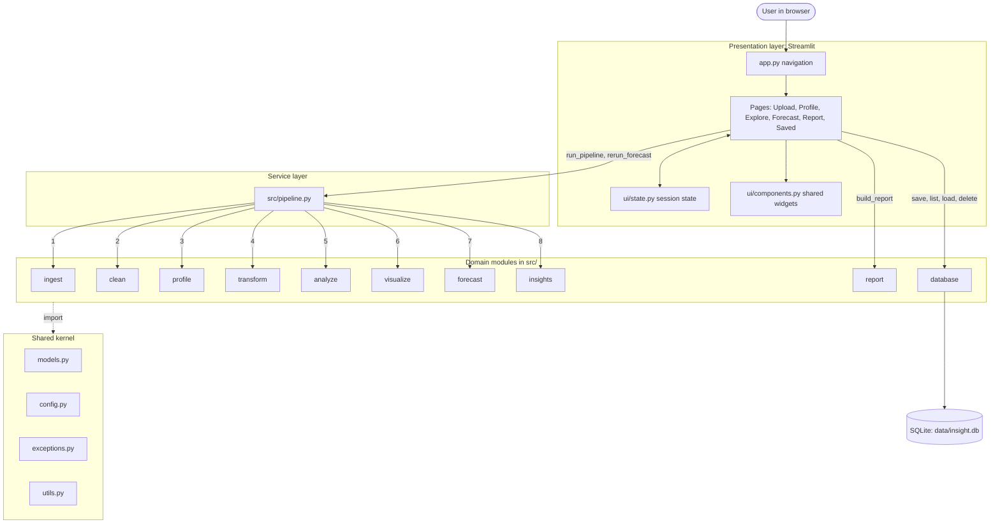
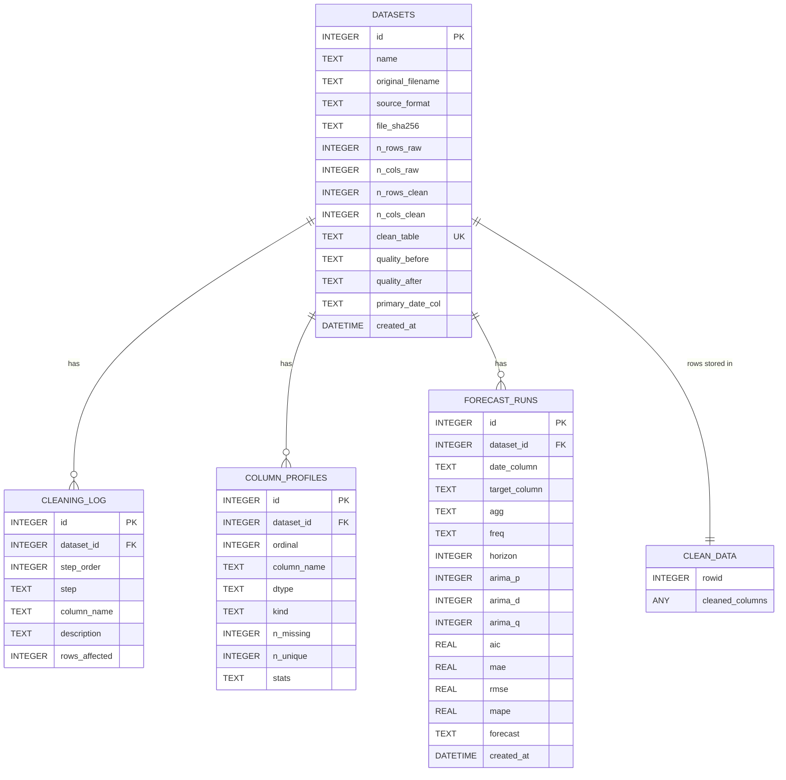
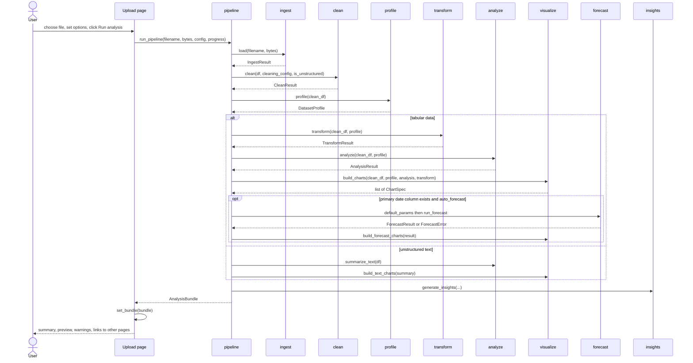
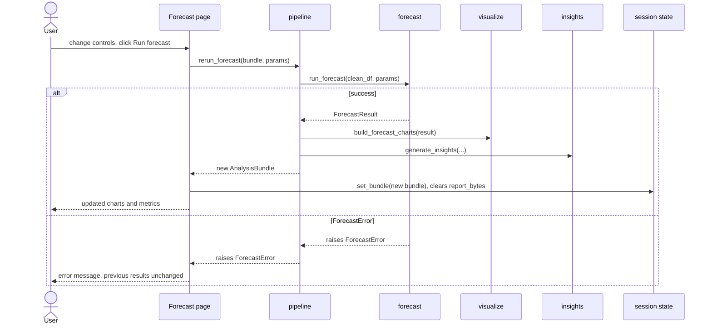
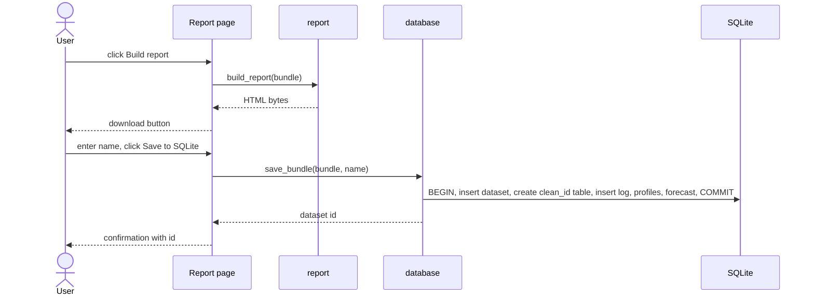
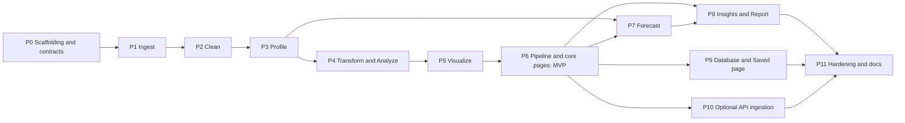

# Auto-Insight Report Generator: Technical Architecture Blueprint

**Purpose of this document:** a precise, implementation-ready blueprint for building the project foundation. It is written to be given directly to an AI coding agent in an IDE.
**Scope:** architecture and contracts only. No application logic is written here. Interface signatures and type definitions are included because they are the contracts between modules.
**Based on:** the project README (Auto-Insight Report Generator, DAV Lab, Ramdeobaba University) and the lab practicals 1 to 8.

---

## 0. Read This First

### 0.1 Rules for the AI coding agent

1. Follow the directory structure in section 2 exactly. Do not add, rename or merge modules without a written reason.
2. `src/` is a pure Python core and must never import `streamlit`. Only `app.py` and `ui/` may import it.
3. All data passed between modules uses the dataclasses and enums in `src/models.py` (section 4.2). Do not pass loose dicts or tuples between modules.
4. Every public function in section 4.3 must exist with the exact name, parameters and return type given.
5. Functions are pure where possible: they must not mutate their input DataFrames (work on `.copy()`).
6. Use only the dependencies in section 7.1. Do not add libraries.
7. All randomness uses `RANDOM_STATE = 42` from `src/config.py`.
8. All thresholds and limits come from `src/config.py` (section 7.2). No magic numbers in module code.
9. Use type hints everywhere and a short docstring on every public function. Python 3.11+ syntax (`X | None`).
10. Non-fatal problems go into a `warnings: list[str]` on the result object. Fatal problems raise an exception from `src/exceptions.py`.
11. Build phase by phase (section 8). Each phase must pass its tests before the next phase starts.
12. Do not log or print dataset contents. Log only counts, column names and stage names.

### 0.2 Key architectural decisions

| # | Decision | Reason |
|---|---|---|
| D1 | **Streamlit monolith with a pure-Python core.** There is no HTTP/REST backend. The "backend" is a service layer (`src/pipeline.py`) called in-process by the Streamlit pages. | The README fixes Streamlit as the front end. A separate API adds a second runtime and deployment for no benefit in a single-user academic tool. |
| D2 | **No authentication or user accounts.** | Local, single-user tool. If it is ever deployed publicly, add Streamlit-level auth then (out of scope). |
| D3 | **Plotly is the only chart renderer inside `src/`.** Matplotlib and Seaborn stay in `requirements.txt` for `notebooks/` lab prototypes only. | One renderer means every chart looks identical in the app and in the exported report, and is interactive in both. |
| D4 | **The exported report is a single self-contained HTML file** built with Jinja2, with Plotly JS embedded once. | No PDF toolchain needed, works offline, and charts stay interactive. |
| D5 | **Pipeline order is Ingest, Clean, Profile, Transform, Analyze, Visualize, Forecast, Insights.** Profiling runs after cleaning because column-type detection needs correct dtypes. | This is a small correction to the README flow diagram (see Appendix A). |
| D6 | **SQLite via SQLAlchemy 2.0** with metadata tables (ORM) plus one dynamic table per saved dataset (`clean_<id>`) written with `DataFrame.to_sql()`. | Matches Lab 5 and the README. |
| D7 | **Insights are deterministic rules**, not an LLM or external service. | Reproducible, offline, explainable in a viva. |
| D8 | **Formats supported: CSV, JSON, XML, TXT** (the README list). Excel and API ingestion are extension points; API-from-URL is an optional late phase. | Avoids scope creep. |
| D9 | **Uploaded files are processed in memory** and never written to disk. Only the cleaned data is saved, and only when the user clicks Save. | Simpler and safer. |
| D10 | **Date-driven forecasting runs automatically** with default parameters when a date column exists, and the user can re-run it with custom parameters. | Matches the README "forecast when dates exist" feature. |

---

## 1. System Architecture

### 1.1 Layers

| Layer | Location | Responsibility |
|---|---|---|
| Presentation | `app.py`, `ui/` | Streamlit navigation, pages, widgets, session state. Calls the service layer only. |
| Service | `src/pipeline.py` | Orchestrates the stages, reports progress, builds the `AnalysisBundle`, re-runs forecasts. |
| Domain modules | `src/*.py` | One responsibility each: ingest, clean, profile, transform, analyze, forecast, visualize, insights, report, database. |
| Shared kernel | `src/models.py`, `config.py`, `exceptions.py`, `utils.py` | Types, constants, errors, small helpers. Imported by everything. |
| Persistence | SQLite file `data/insight.db` | Saved datasets, cleaning logs, column profiles, forecast runs. |

### 1.2 Component diagram



### 1.3 Module dependency rules

| Module | May import from `src/` | Must not import |
|---|---|---|
| `models`, `config`, `exceptions` | nothing (`models` may import `config` enums only if needed) | any domain module |
| `utils` | `config`, `exceptions` | any domain module |
| `ingest`, `clean`, `profile`, `transform`, `analyze`, `forecast`, `insights` | `models`, `config`, `exceptions`, `utils` | each other, `pipeline`, `visualize`, `report`, `database`, `streamlit` |
| `visualize` | `models`, `config`, `utils` | other domain modules |
| `report` | `models`, `config`, `exceptions`, `utils` | other domain modules |
| `database` | `models`, `config`, `exceptions`, `utils` | other domain modules |
| `pipeline` | every domain module | `streamlit`, `report`, `database` |
| `ui/*`, `app.py` | `pipeline`, `report`, `database`, `models`, `exceptions`, `config`, `visualize` (forecast charts are built in `pipeline`, so `visualize` is only needed for type imports) | none of the domain modules directly except those listed |

Domain modules talk to each other only through `models.py` types, orchestrated by `pipeline.py`. This keeps modules independently testable and lets several people work in parallel.

### 1.4 Runtime model

- One Streamlit process, one user session at a time.
- Heavy computation happens only when the user clicks a button (Run analysis, Run forecast, Build report, Save).
- Results live in `st.session_state` as one `AnalysisBundle` object.
- Nothing is cached across sessions except what the user explicitly saves to SQLite.

---

## 2. Project Structure

```
auto-insight-report-generator/
├── app.py                         # Streamlit entry point: page config + st.navigation
├── requirements.txt
├── pytest.ini
├── README.md
├── ARCHITECTURE.md                # this document
├── .gitignore
├── .streamlit/
│   └── config.toml                # upload size limit, theme, telemetry off
├── data/
│   ├── samples/                   # committed small sample inputs (see Appendix B)
│   └── insight.db                 # created at runtime, git-ignored
├── notebooks/                     # lab prototypes (Labs 1 to 8); NOT imported by src/
├── scripts/
│   └── generate_samples.py        # deterministic generator for data/samples/*
├── src/
│   ├── __init__.py
│   ├── config.py                  # constants, thresholds, default paths
│   ├── exceptions.py              # InsightError hierarchy
│   ├── models.py                  # enums + dataclasses (all shared types)
│   ├── utils.py                   # logging, snake_case, safe parsers, sha256
│   ├── ingest.py                  # CSV/JSON/XML/TXT -> DataFrame
│   ├── clean.py                   # cleaning steps + cleaning log + quality stats
│   ├── profile.py                 # column type classification + column profiles
│   ├── transform.py               # scaling, encoding, binning, aggregation
│   ├── analyze.py                 # descriptive stats, correlation, regression, text summary
│   ├── forecast.py                # SMA/EMA, decomposition, ARIMA, backtest
│   ├── visualize.py               # automatic chart selection -> Plotly figures
│   ├── insights.py                # rule-based plain-language insights
│   ├── report.py                  # HTML report builder (Jinja2)
│   ├── database.py                # SQLAlchemy engine, ORM tables, save/list/load/delete
│   ├── pipeline.py                # orchestrator: run_pipeline, rerun_forecast
│   └── templates/
│       └── report.html.j2         # report template
├── ui/
│   ├── __init__.py
│   ├── state.py                   # typed session_state accessors
│   ├── components.py              # reusable widgets
│   └── pages/
│       ├── upload.py              # Upload and run analysis
│       ├── profile.py             # Data profile, cleaning log, transformed data
│       ├── explore.py             # Auto-generated charts
│       ├── forecast.py            # Time-series analysis
│       ├── report.py              # Report download, CSV downloads, save to DB
│       └── saved.py               # Saved datasets browser
└── tests/
    ├── conftest.py                # synthetic dataset fixtures
    ├── test_ingest.py
    ├── test_clean.py
    ├── test_profile.py
    ├── test_transform_analyze.py
    ├── test_visualize.py
    ├── test_forecast.py
    ├── test_report.py
    ├── test_database.py
    └── test_pipeline_e2e.py
```

### 2.1 File responsibilities

| Path | Responsibility |
|---|---|
| `app.py` | Calls `st.set_page_config`, defines the six `st.Page` objects, runs `st.navigation`. Contains no logic. |
| `.streamlit/config.toml` | `server.maxUploadSize = 50`, `browser.gatherUsageStats = false`, light theme. |
| `src/config.py` | Every constant in section 7.2, plus `PipelineConfig` defaults and `DB_PATH` (overridable by env var). |
| `src/exceptions.py` | Exception hierarchy (section 7.5). |
| `src/models.py` | All enums and dataclasses (section 4.2). Types only, no logic. |
| `src/utils.py` | `get_logger`, `to_snake_case`, `unique_names`, `try_parse_numeric`, `try_parse_datetime`, `sha256_bytes`. |
| `src/ingest.py` | Detect format by extension and content, parse to a raw DataFrame, return `IngestResult`. |
| `src/clean.py` | Apply the ordered cleaning steps (section 4.3.2), record every action, compute before/after quality stats. |
| `src/profile.py` | Classify each column into a `ColumnKind`, compute per-column statistics, pick the primary date column. |
| `src/transform.py` | Produce min-max scaled, standard-scaled, label-encoded, one-hot encoded, binned and aggregated views. |
| `src/analyze.py` | Descriptive statistics, correlation matrix, top correlated pairs, linear regression, text summary for unstructured data. |
| `src/forecast.py` | Resample to a time series, compute SMA/EMA, decompose, select ARIMA order, backtest, forecast. Returns data only (no figures). |
| `src/visualize.py` | Apply the chart selection rules (section 4.3.6) and return `ChartSpec` objects holding Plotly figures. Also builds forecast and text charts. |
| `src/insights.py` | Apply the fixed insight rules (section 4.3.9). |
| `src/report.py` | Render `AnalysisBundle` to HTML bytes. |
| `src/database.py` | Engine creation, table creation, save, list, load, delete. |
| `src/pipeline.py` | Orchestrate all stages and expose the two public entry points. |
| `ui/state.py` | One place that defines and reads/writes `st.session_state` keys. |
| `ui/components.py` | Shared widgets: chart renderer, metric row, warning list, DataFrame view, `require_bundle` guard. |
| `ui/pages/*.py` | One Streamlit page each (section 5). |

---

## 3. Database Design

### 3.1 Purpose and scope

The database is **optional persistence** (README: "optional database storage"). The analysis works fully without it. It stores only what the user saves: the cleaned data, the cleaning log, the column profiles and the latest forecast.

- Engine: SQLite file at `DB_PATH` (default `data/insight.db`).
- Access: SQLAlchemy 2.0. Metadata tables are declared with the ORM (`DeclarativeBase`). Cleaned data is written with `DataFrame.to_sql()`.
- On every new connection execute `PRAGMA foreign_keys = ON` (SQLAlchemy `connect` event listener).
- Tables are created with `Base.metadata.create_all(engine)` in `init_db`. No migration tool.

### 3.2 ER diagram



`CLEAN_DATA` represents the dynamic table `clean_<dataset_id>`; its columns are the cleaned dataset's columns.

### 3.3 Table definitions

**`datasets`**

| Column | Type | Constraints |
|---|---|---|
| `id` | INTEGER | PRIMARY KEY AUTOINCREMENT |
| `name` | TEXT | NOT NULL (defaults to the filename; editable at save time) |
| `original_filename` | TEXT | NOT NULL |
| `source_format` | TEXT | NOT NULL, CHECK in ('csv','json','xml','txt') |
| `file_sha256` | TEXT | NOT NULL |
| `n_rows_raw`, `n_cols_raw` | INTEGER | NOT NULL, CHECK >= 0 |
| `n_rows_clean`, `n_cols_clean` | INTEGER | NOT NULL, CHECK >= 0 |
| `clean_table` | TEXT | NOT NULL, UNIQUE (always `clean_<id>`) |
| `quality_before`, `quality_after` | TEXT | NOT NULL, JSON text of `QualityStats` |
| `primary_date_col` | TEXT | NULL |
| `created_at` | DATETIME | NOT NULL, default CURRENT_TIMESTAMP |

Indexes: `ix_datasets_sha256(file_sha256)`, `ix_datasets_created(created_at)`.

**`cleaning_log`**

| Column | Type | Constraints |
|---|---|---|
| `id` | INTEGER | PRIMARY KEY AUTOINCREMENT |
| `dataset_id` | INTEGER | NOT NULL, FOREIGN KEY to `datasets(id)` ON DELETE CASCADE |
| `step_order` | INTEGER | NOT NULL |
| `step` | TEXT | NOT NULL (value of `CleaningStep`) |
| `column_name` | TEXT | NULL (null for table-wide steps) |
| `description` | TEXT | NOT NULL |
| `rows_affected` | INTEGER | NOT NULL DEFAULT 0 |

Constraint: UNIQUE(`dataset_id`, `step_order`). This unique index also serves lookups by dataset.

**`column_profiles`**

| Column | Type | Constraints |
|---|---|---|
| `id` | INTEGER | PRIMARY KEY AUTOINCREMENT |
| `dataset_id` | INTEGER | NOT NULL, FOREIGN KEY ON DELETE CASCADE |
| `ordinal` | INTEGER | NOT NULL (column position) |
| `column_name` | TEXT | NOT NULL |
| `dtype` | TEXT | NOT NULL |
| `kind` | TEXT | NOT NULL, CHECK in the `ColumnKind` values |
| `n_missing` | INTEGER | NOT NULL |
| `n_unique` | INTEGER | NOT NULL |
| `stats` | TEXT | NULL, JSON text (numeric stats, top values or date range) |

Constraint: UNIQUE(`dataset_id`, `column_name`).

**`forecast_runs`**

| Column | Type | Constraints |
|---|---|---|
| `id` | INTEGER | PRIMARY KEY AUTOINCREMENT |
| `dataset_id` | INTEGER | NOT NULL, FOREIGN KEY ON DELETE CASCADE |
| `date_column`, `target_column` | TEXT | NOT NULL |
| `agg` | TEXT | NOT NULL, CHECK in ('sum','mean') |
| `freq` | TEXT | NOT NULL, CHECK in ('D','W','MS') |
| `horizon` | INTEGER | NOT NULL, CHECK >= 1 |
| `arima_p`, `arima_d`, `arima_q` | INTEGER | NOT NULL |
| `aic` | REAL | NOT NULL |
| `mae`, `rmse`, `mape` | REAL | NULL (null when backtest skipped) |
| `forecast` | TEXT | NOT NULL, JSON list of `{date, forecast, lower, upper}` |
| `created_at` | DATETIME | NOT NULL, default CURRENT_TIMESTAMP |

Index: `ix_forecast_runs_dataset(dataset_id)`.

**`clean_<dataset_id>` (dynamic)**

- Created by `df.to_sql(name, conn, if_exists="fail", index=False)`.
- The name is generated by code from the integer id, never from user input.
- No primary key or indexes (read-only snapshot, always read whole or with `LIMIT`).
- Datetime columns are stored as ISO text by pandas.

### 3.4 Save and delete behaviour

**Save (`save_bundle`)** runs in one transaction (`with engine.begin() as conn`):

1. Insert a `datasets` row with `clean_table = "pending_" + uuid4().hex` (satisfies NOT NULL and UNIQUE).
2. Read the generated `id`, update `clean_table` to `clean_<id>`.
3. `bundle.clean.df.to_sql(clean_table, conn, if_exists="fail", index=False)`.
4. Insert one `cleaning_log` row per `CleaningAction`, with `step_order` starting at 1.
5. Insert one `column_profiles` row per `ColumnProfile`.
6. If `bundle.forecast` exists, insert one `forecast_runs` row.
7. Commit. Any exception rolls everything back and raises `StorageError`.

**Delete (`delete_dataset`)** in one transaction: drop table `clean_<id>` (identifier validated against the pattern `^clean_\d+$` before use), then delete the `datasets` row. Child rows are removed by ON DELETE CASCADE.

---

## 4. Backend Architecture

### 4.1 Interface style

The user asked for API endpoints. Per decision D1 there is **no HTTP API**. The equivalent is the in-process **service interface**: the public functions in section 4.3, called directly by Streamlit pages. The request and response formats are the dataclasses in section 4.2.

| Concern | Decision |
|---|---|
| Authentication | None (D2). |
| Transport | Direct Python function calls. |
| Request format | Function arguments plus the config dataclasses `PipelineConfig`, `CleaningConfig`, `ForecastParams`. |
| Response format | Result dataclasses, always containing `warnings: list[str]` where non-fatal issues can occur. |
| Errors | Exceptions derived from `InsightError`, each carrying a `user_message` (section 7.5). |
| Future REST option | A FastAPI wrapper around `src.pipeline` could be added later without changing `src/`. It is explicitly out of scope. |

### 4.2 Shared types (`src/models.py`)

Types only, no logic. Field names and types are the contract.

```python
from __future__ import annotations
from dataclasses import dataclass, field
from datetime import datetime
from enum import Enum
import pandas as pd
import plotly.graph_objects as go

# ---------- Enums ----------
class SourceFormat(str, Enum):
    CSV = "csv"; JSON = "json"; XML = "xml"; TXT = "txt"

class ColumnKind(str, Enum):
    NUMERIC = "numeric"; CATEGORICAL = "categorical"; BOOLEAN = "boolean"
    DATETIME = "datetime"; TEXT = "text"; HIGH_CARDINALITY = "high_cardinality"
    ID_LIKE = "id_like"; CONSTANT = "constant"

class OutlierTreatment(str, Enum):
    FLAG = "flag"; CAP = "cap"; REMOVE = "remove"

class CleaningStep(str, Enum):
    RENAME_COLUMNS = "rename_columns"; TRIM_TEXT = "trim_text"; NA_TOKENS = "na_tokens"
    COERCE_NUMERIC = "coerce_numeric"; COERCE_DATETIME = "coerce_datetime"
    DROP_EMPTY_ROWS = "drop_empty_rows"; DROP_DUPLICATES = "drop_duplicates"
    DROP_COLUMN = "drop_column"; IMPUTE = "impute"
    HARMONIZE_CATEGORY = "harmonize_category"; OUTLIERS = "outliers"

class ChartKind(str, Enum):
    HISTOGRAM = "histogram"; BOX = "box"; BAR = "bar"; PIE = "pie"; DONUT = "donut"
    SCATTER = "scatter"; HEATMAP = "heatmap"; LINE = "line"
    DECOMPOSITION = "decomposition"; FORECAST = "forecast"

class ChartGroup(str, Enum):
    DISTRIBUTION = "distribution"; CATEGORY = "category"; RELATIONSHIP = "relationship"
    TEXT = "text"; TIME_SERIES = "time_series"

# ---------- Configuration ----------
@dataclass
class CleaningConfig:
    outlier_treatment: OutlierTreatment = OutlierTreatment.FLAG
    drop_column_missing_pct: float = 0.60      # drop columns missing more than this share
    iqr_k: float = 1.5

@dataclass
class PipelineConfig:
    cleaning: CleaningConfig = field(default_factory=CleaningConfig)
    auto_forecast: bool = True

@dataclass
class ForecastParams:
    date_col: str
    target_col: str
    agg: str = "sum"                           # "sum" or "mean"
    horizon: int = 3                           # 1..MAX_HORIZON
    decomposition_model: str = "additive"      # "additive" or "multiplicative"

# ---------- Ingest ----------
@dataclass
class IngestResult:
    df: pd.DataFrame
    source_format: SourceFormat
    is_unstructured: bool                      # True only for free-text .txt
    file_sha256: str
    warnings: list[str] = field(default_factory=list)

@dataclass
class SourceInfo:                              # what the bundle remembers about the upload
    filename: str
    source_format: SourceFormat
    file_sha256: str
    n_rows_raw: int
    n_cols_raw: int
    is_unstructured: bool
    raw_preview: pd.DataFrame                  # first RAW_PREVIEW_ROWS rows of the raw data
    warnings: list[str] = field(default_factory=list)

# ---------- Cleaning ----------
@dataclass
class CleaningAction:
    step: CleaningStep
    column: str | None
    description: str
    rows_affected: int

@dataclass
class QualityStats:
    n_rows: int
    n_cols: int
    missing_cells: int
    duplicate_rows: int
    outlier_cells: int                         # IQR rule, numeric columns only

@dataclass
class CleanResult:
    df: pd.DataFrame
    actions: list[CleaningAction]
    quality_before: QualityStats
    quality_after: QualityStats
    rename_map: dict[str, str]                 # original name -> cleaned name
    warnings: list[str] = field(default_factory=list)

# ---------- Profile ----------
@dataclass
class ColumnProfile:
    name: str
    dtype: str
    kind: ColumnKind
    n_missing: int
    pct_missing: float
    n_unique: int
    unique_ratio: float
    sample_values: list[str]                   # up to 3
    numeric_stats: dict[str, float] | None     # min,max,mean,median,std,skew
    top_values: list[tuple[str, int]] | None   # up to 5, categorical/boolean only
    date_range: tuple[str, str] | None         # ISO strings, datetime only

@dataclass
class DatasetProfile:
    n_rows: int
    n_cols: int
    columns: list[ColumnProfile]
    primary_date_col: str | None
    memory_mb: float
    # helper accessors (implemented as @property in the dataclass):
    #   cols_of(kind: ColumnKind) -> list[str]

# ---------- Transform ----------
@dataclass
class TransformResult:
    scaled_minmax: pd.DataFrame                # NUMERIC columns, range 0..1
    scaled_standard: pd.DataFrame              # NUMERIC columns, mean 0, std 1
    label_encoded: pd.DataFrame                # CATEGORICAL + BOOLEAN, integer codes
    one_hot: pd.DataFrame                      # CATEGORICAL + BOOLEAN, 0/1 columns
    binned: pd.DataFrame                       # one "<col>_bin" column per NUMERIC column
    aggregations: dict[str, pd.DataFrame]      # key "by_<categorical>", max 2 entries
    ml_ready: pd.DataFrame                     # scaled_standard + one_hot, side by side
    warnings: list[str] = field(default_factory=list)

# ---------- Analysis ----------
@dataclass
class CorrPair:
    x: str
    y: str
    r: float

@dataclass
class RegressionResult:
    x: str
    y: str
    coef: float
    intercept: float
    r2: float
    mae: float
    rmse: float
    n_train: int
    n_test: int
    y_test: list[float]
    y_pred: list[float]

@dataclass
class TextSummary:
    n_lines: int
    n_words: int
    avg_words_per_line: float
    top_words: list[tuple[str, int]]           # top TOP_WORDS_N, stop words removed

@dataclass
class AnalysisResult:
    descriptive: pd.DataFrame | None           # one row per NUMERIC column
    correlation: pd.DataFrame | None           # Pearson matrix or None if < 2 numeric columns
    top_pairs: list[CorrPair]                  # sorted by abs(r), desc
    regression: RegressionResult | None
    text_summary: TextSummary | None           # only for unstructured input
    warnings: list[str] = field(default_factory=list)

# ---------- Visualization ----------
@dataclass
class ChartSpec:
    id: str                                    # unique, e.g. "hist__sales"
    title: str
    kind: ChartKind
    group: ChartGroup
    columns: list[str]
    figure: go.Figure
    description: str                           # one plain-language line

# ---------- Forecast ----------
@dataclass
class DecompositionResult:
    model: str
    observed: pd.Series
    trend: pd.Series
    seasonal: pd.Series
    resid: pd.Series
    period: int

@dataclass
class BacktestResult:
    actual: pd.Series
    predicted: pd.Series
    mae: float
    rmse: float
    mape: float | None                         # None if actual contains zeros only

@dataclass
class ForecastResult:
    params: ForecastParams
    freq: str                                  # "D", "W" or "MS"
    seasonal_period: int
    series: pd.Series                          # resampled target series (DatetimeIndex)
    sma: pd.Series
    ema: pd.Series
    sma_window: int
    ema_span: int
    decomposition: DecompositionResult | None
    adf_pvalue: float
    order: tuple[int, int, int]                # (p, d, q)
    aic: float
    backtest: BacktestResult | None
    forecast: pd.DataFrame                     # index = future dates; columns forecast, lower, upper
    warnings: list[str] = field(default_factory=list)

# ---------- Insights ----------
@dataclass
class Insight:
    level: str                                 # "info" or "warning"
    category: str                              # "quality","distribution","relationship","regression","timeseries"
    text: str

# ---------- Bundle (the one object the UI holds) ----------
@dataclass
class AnalysisBundle:
    source: SourceInfo
    clean: CleanResult
    profile: DatasetProfile
    transform: TransformResult | None          # None for unstructured input
    analysis: AnalysisResult
    charts: list[ChartSpec]
    forecast: ForecastResult | None
    forecast_charts: list[ChartSpec]
    forecast_error: str | None                 # user-readable reason if auto-forecast failed or was skipped
    insights: list[Insight]
    config: PipelineConfig
    created_at: datetime

# ---------- Persistence listing ----------
@dataclass
class DatasetRecord:
    id: int
    name: str
    original_filename: str
    source_format: str
    n_rows_clean: int
    n_cols_clean: int
    created_at: datetime
```

### 4.3 Module specifications

#### 4.3.1 `ingest.py`

```python
def load(filename: str, content: bytes) -> IngestResult: ...
def load_from_url(url: str) -> IngestResult: ...        # Phase 10 only (optional)
```

Behaviour:

- Format is chosen from the lowercase file extension. Extensions outside `SUPPORTED_EXTENSIONS` raise `UnsupportedFormatError`. Content larger than `MAX_UPLOAD_MB` raises `IngestError`.
- Compute `file_sha256` with `utils.sha256_bytes`.
- **CSV:** decode by trying `utf-8`, `utf-8-sig`, then `latin-1` (add a warning if latin-1 was used). Parse with `pd.read_csv(sep=None, engine="python")` so the delimiter is sniffed.
- **JSON:** `json.loads`. If the top level is a list of objects, use `pd.json_normalize(data, sep="_")`. If it is a dict containing exactly one list of objects, normalize that list. If it is a dict of equal-length lists, build a DataFrame directly. Anything else raises `IngestError("JSON structure not tabular")`.
- **XML:** parse with `defusedxml.ElementTree` only (never `xml.etree` directly, and never `pd.read_xml`). Find the *record element*: the most frequent child tag under the root, descending one level if the root has a single child wrapper. Each record becomes one row: its attributes plus its direct children's text (children with their own children are flattened one level as `parent_child`). If no repeating element exists raise `IngestError`.
- **TXT:** first try `csv.Sniffer` on the first 20 non-empty lines. If a delimiter is found and at least 2 columns appear consistently, treat as delimited text and parse as CSV. Otherwise treat as **unstructured**: return a DataFrame with columns `line_no` (1-based) and `text` (one row per non-empty line) and `is_unstructured = True`.
- Raise `EmptyDatasetError` if the result has 0 rows or 0 columns.
- Never execute or evaluate content from files.

#### 4.3.2 `clean.py`

```python
def clean(df: pd.DataFrame, config: CleaningConfig, is_unstructured: bool = False) -> CleanResult: ...
```

Ordered steps (every step that changes data appends a `CleaningAction`):


| Step | Rule |
|---|---|
| 1 Rename | `utils.to_snake_case` on every name, then `utils.unique_names` to dedupe with `_2`, `_3` suffixes. Store the mapping in `rename_map`. |
| 2 Trim and NA | Strip leading/trailing whitespace and collapse internal whitespace in object columns. Replace values whose lowercase form is in `NA_TOKENS` with `NaN`. |
| 3 Coerce | For each object column: strip currency symbols, thousands separators and `%`, then convert to numeric if at least `NUMERIC_PARSE_MIN_RATIO` of non-null values parse. Otherwise try datetime (`try_parse_datetime`) if at least `DATETIME_PARSE_MIN_RATIO` parse. Numeric-typed columns are never converted to dates. |
| Snapshot | `quality_before`: rows, cols, missing cells, duplicate rows, IQR outlier cells (numeric columns). |
| 4 Drop rows | Drop rows where every cell is null. Drop exact duplicate rows keeping the first. |
| 5 Drop columns | Drop columns whose missing share exceeds `config.drop_column_missing_pct`. |
| 6 Impute | Numeric: median. Categorical/object/bool: the literal `"Unknown"`. Datetime: left as `NaT` (not imputed). |
| 7 Harmonize | For object columns with at most `CATEGORICAL_MAX_UNIQUE` distinct values: group values that differ only by case or whitespace and rewrite them to the most frequent spelling (generalizes Lab 2's "USA / U.S.A. / United States" fix for the case/whitespace part). |
| 8 Outliers | IQR fences per numeric column with `config.iqr_k`. `FLAG` leaves data unchanged and logs counts. `CAP` clips to the fences. `REMOVE` drops rows outside the fences (applied column by column, logged per column). |
| Snapshot | `quality_after` computed on the final DataFrame. |

Unstructured input (`is_unstructured=True`): run only steps 1, 2 and drop-empty-rows. Skip everything else.

Raise `EmptyDatasetError` if no rows or no columns remain.

#### 4.3.3 `profile.py`

```python
def classify_column(s: pd.Series) -> ColumnKind: ...
def profile(df: pd.DataFrame) -> DatasetProfile: ...
```

`classify_column` applies these rules in order (first match wins). `n_unique` and `unique_ratio` are computed on non-null values.

| Order | Condition | Kind |
|---|---|---|
| 1 | `n_unique <= 1` | `CONSTANT` |
| 2 | datetime dtype | `DATETIME` |
| 3 | bool dtype | `BOOLEAN` |
| 4 | integer dtype and `unique_ratio >= ID_UNIQUE_RATIO` | `ID_LIKE` |
| 5 | any other numeric dtype | `NUMERIC` |
| 6 | object/string/category and mean string length >= `TEXT_MIN_AVG_LEN` | `TEXT` |
| 7 | object/string/category and `unique_ratio >= ID_UNIQUE_RATIO` | `ID_LIKE` |
| 8 | object/string/category and `n_unique <= CATEGORICAL_MAX_UNIQUE` | `CATEGORICAL` |
| 9 | otherwise | `HIGH_CARDINALITY` |

`profile` fills `primary_date_col`: among `DATETIME` columns, the one with the most unique values (ties broken by column order); `None` if there are none.

#### 4.3.4 `transform.py`

```python
def transform(df: pd.DataFrame, profile: DatasetProfile) -> TransformResult: ...
```

- Numeric inputs are columns of kind `NUMERIC`. Categorical inputs are kinds `CATEGORICAL` and `BOOLEAN`.
- `scaled_minmax`: `sklearn.preprocessing.MinMaxScaler`. `scaled_standard`: `StandardScaler`.
- `label_encoded`: `OrdinalEncoder` on categorical inputs (integer codes, categories sorted).
- `one_hot`: `pd.get_dummies(dtype=int)`. If the result would exceed `ENCODED_MAX_COLUMNS`, return an empty DataFrame and add a warning.
- `binned`: for each numeric column, `pd.qcut(q=4, labels=["Q1 (low)","Q2","Q3","Q4 (high)"], duplicates="drop")`. If qcut fails (too few distinct values), fall back to `pd.cut(bins=4)` with generic labels. Output column name is `<col>_bin`.
- `aggregations`: pick up to 2 categorical columns with the lowest number of distinct values (minimum 2, ties by column order). For each, `groupby(cat)` over the first 3 numeric columns with `agg(["mean","sum","min","max","count"])`, columns flattened to `<col>_<stat>`. Key is `by_<cat>`.
- `ml_ready`: `scaled_standard` joined with `one_hot` (same row order).
- Each output is empty (not `None`) when its inputs do not exist. The index of every output equals the index of `df`.

#### 4.3.5 `analyze.py`

```python
def analyze(df: pd.DataFrame, profile: DatasetProfile) -> AnalysisResult: ...
def summarize_text(df: pd.DataFrame) -> TextSummary: ...     # for unstructured input
```

- `descriptive`: one row per numeric column with mean, median, mode (first mode), std, variance, min, max, range, q1, q3, skew.
- `correlation`: Pearson on `NUMERIC` columns only; `None` if fewer than 2 numeric columns. Limited to the first `HEATMAP_MAX_COLS` numeric columns.
- `top_pairs`: up to `TOP_PAIRS_N` pairs with `abs(r) >= SCATTER_MIN_ABS_R`, sorted by `abs(r)` descending, each pair once.
- `regression`: take the top pair (if any) and fit `LinearRegression` with `train_test_split(test_size=REGRESSION_TEST_SIZE, random_state=RANDOM_STATE)`. Skip (and set `None`) if fewer than `REGRESSION_MIN_ROWS` rows. The independent variable is the first element of the pair.
- `summarize_text`: lowercase, tokenize on `[a-z']+`, remove `sklearn.feature_extraction.text.ENGLISH_STOP_WORDS`, count words with `collections.Counter`.

#### 4.3.6 `visualize.py`

```python
def build_charts(df: pd.DataFrame, profile: DatasetProfile,
                 analysis: AnalysisResult, transform: TransformResult) -> list[ChartSpec]: ...
def build_text_charts(summary: TextSummary) -> list[ChartSpec]: ...
def build_forecast_charts(result: ForecastResult) -> list[ChartSpec]: ...
```

All figures use Plotly with template `PLOTLY_TEMPLATE` and colour sequence `COLOR_SEQUENCE`. Every function returns an empty list when its inputs do not exist (never raises for missing column types).

**Automatic chart selection rules**

| Input | Chart(s) | ChartKind / Group | Id pattern |
|---|---|---|---|
| Each of the first `MAX_NUMERIC_CHART_COLS` NUMERIC columns | Histogram (30 bins computed with `numpy.histogram`, drawn as `go.Bar`) | HISTOGRAM / DISTRIBUTION | `hist__<col>` |
| Same columns | Box plot (sample at most `CHART_MAX_POINTS` values, seed fixed) | BOX / DISTRIBUTION | `box__<col>` |
| Each of the first `MAX_CATEGORICAL_CHART_COLS` CATEGORICAL/BOOLEAN columns | 2 to 4 distinct values: pie. 5 to 8: donut (hole 0.45). More than 8: horizontal bar of the top `TOP_N_BAR` counts | PIE / DONUT / BAR, group CATEGORY | `cat__<col>` |
| Each HIGH_CARDINALITY column (max 2) | Horizontal bar of top `TOP_N_BAR` counts | BAR / CATEGORY | `top__<col>` |
| Each key in `transform.aggregations` x the first 2 numeric columns in that table | Bar of the group mean | BAR / CATEGORY | `catnum__<cat>__<num>` |
| First categorical column in `aggregations` x first numeric column | Grouped box plot | BOX / CATEGORY | `boxby__<cat>__<num>` |
| Each pair in `analysis.top_pairs` (max `MAX_SCATTER_PAIRS`) | Scatter (sample at most `CHART_MAX_POINTS`) with a least-squares line from `np.polyfit(deg=1)` and r in the title | SCATTER / RELATIONSHIP | `scatter__<x>__<y>` |
| `analysis.correlation` (if not None) | Heatmap, range -1 to 1, cell annotations with 2 decimals | HEATMAP / RELATIONSHIP | `heatmap__corr` |

`build_text_charts`: one horizontal bar of the top `TOP_WORDS_N` words (`text__top_words`, group TEXT).

`build_forecast_charts(result)` returns three charts (group TIME_SERIES):

| Id | Content |
|---|---|
| `ts__trend` | Series line plus SMA and EMA overlays (kind LINE). |
| `ts__decomposition` | `make_subplots` with 4 stacked panels: observed, trend, seasonal, residual. Omitted if `decomposition is None`. |
| `ts__forecast` | History (last `max(24, 5 * horizon)` points), backtest predictions as a dashed line if present, forecast line with a shaded confidence band. |

Every `ChartSpec.description` is a single plain sentence, for example "Distribution of sales across 51,290 rows."

#### 4.3.7 `forecast.py`

```python
def default_params(df: pd.DataFrame, profile: DatasetProfile) -> ForecastParams | None: ...
def run_forecast(df: pd.DataFrame, params: ForecastParams) -> ForecastResult: ...   # raises ForecastError
```

`default_params`: return `None` if `profile.primary_date_col` is `None` or there is no `NUMERIC` column. Otherwise `date_col = primary_date_col`, `target_col =` the first `NUMERIC` column, `horizon = DEFAULT_HORIZON`, `decomposition_model = "additive"`. `agg = "sum"` if the target name matches the regex `(sales|revenue|profit|quantity|qty|amount|count|total|cost|orders)`, else `"mean"`.

`run_forecast` algorithm:

1. Drop rows where the date or target is null. Sort by date. Raise `ForecastError` if fewer than 2 distinct dates.
2. **Frequency:** median gap between sorted unique dates. At most 1.5 days gives `"D"`. At most 10 days gives `"W"`. Otherwise `"MS"`.
3. Resample with `params.agg`. Fill empty periods with `interpolate(method="time")` then `ffill`/`bfill`. If more than 10% of periods were filled, add a warning.
4. Raise `ForecastError` if the series has fewer than `FORECAST_MIN_POINTS` points.
5. Set `seasonal_period` from `FREQ_SETTINGS[freq]` (D: 7, W: 52, MS: 12) and the SMA window / EMA span from the same table.
6. SMA = `rolling(window).mean()`, EMA = `ewm(span, adjust=False).mean()`.
7. **Decomposition:** requires at least `2 * seasonal_period` points, otherwise set `None` and add a warning. Use `seasonal_decompose(period, extrapolate_trend="freq")`. If `multiplicative` is requested but the series has values <= 0, fall back to additive and warn.
8. **Stationarity:** run `adfuller`. `d = 0` if p < `ADF_ALPHA`; otherwise difference once and test again, up to `ARIMA_MAX_D`.
9. **Order selection:** fit `ARIMA(series, order=(p, d, q), trend="c" if d == 0 else "n")` for every `p, q` in `0..ARIMA_MAX_P` / `0..ARIMA_MAX_Q`. Suppress convergence warnings. Choose the lowest AIC. If every fit fails, raise `ForecastError`.
10. **Backtest:** if `len(series) - horizon >= FORECAST_MIN_POINTS`, refit the chosen order on all but the last `horizon` points, forecast those `horizon` points, and compute MAE, RMSE and MAPE (ignore zero actuals; `None` if all zero). Otherwise `backtest = None` with a warning.
11. **Final forecast:** refit on the full series, `get_forecast(horizon)`, confidence interval at `FORECAST_CONF_LEVEL`. Output columns `forecast`, `lower`, `upper`.

This module returns data only. Figures are built by `visualize.build_forecast_charts`.

#### 4.3.8 `report.py`

```python
def build_report(bundle: AnalysisBundle) -> bytes: ...      # UTF-8 HTML
```

- Jinja2 `Environment` with `autoescape=True` set explicitly (the template filename ends in `.j2`, so extension-based autoescape would not trigger).
- Only Plotly chart HTML is marked safe: `fig.to_html(full_html=False, include_plotlyjs=False)`. The Plotly JS bundle (`plotly.offline.get_plotlyjs()`) is inlined once in `<head>`.
- DataFrames are rendered with `to_html(escape=True, max_rows=REPORT_TABLE_MAX_ROWS)`.
- Sections in order: 1 Overview, 2 Data quality (before/after table and cleaning log), 3 Column profile, 4 Key statistics, 5 Insights, 6 Charts grouped by `ChartGroup`, 7 Time series and forecast (omitted if `bundle.forecast is None`), 8 Regression and transformation summary (omitted if `transform is None`).
- Raise `ReportError` on template or rendering failure.

#### 4.3.9 `insights.py`

```python
def generate_insights(clean: CleanResult, profile: DatasetProfile,
                      analysis: AnalysisResult, forecast: ForecastResult | None) -> list[Insight]: ...
```

Fixed rule list (each rule emits zero or more `Insight`s; order of rules is the output order):

| Rule | Condition | Level | Category |
|---|---|---|---|
| R1 | For the 3 `IMPUTE` actions with the most rows affected: "Filled N missing values in `col` with median/Unknown." | info | quality |
| R2 | `DROP_DUPLICATES` action with `rows_affected > 0` | info | quality |
| R3 | Column where IQR outliers exceed 5% of rows (from `OUTLIERS` actions) | warning | quality |
| R4 | Numeric column with `abs(skew) > 1`: "highly right/left-skewed" | info | distribution |
| R5 | Up to 3 pairs in `top_pairs` with `abs(r) >= 0.7`: strong positive/negative relationship | info | relationship |
| R6 | Categorical column whose top value share is at least 50% | info | distribution |
| R7 | Regression present: report R2 as held-out explained variance. If R2 < 0.1, level warning ("weak linear relationship") | info or warning | regression |
| R8 | Forecast present: trend direction (OLS slope over the series; "flat" if the total change over the series is below 5% of its mean), peak seasonal period if decomposition exists, forecast direction (last forecast vs last actual), backtest MAPE quality (below 10% good, 10 to 25% fair, above 25% poor) | info | timeseries |
| R9 | Columns classified `ID_LIKE` or `CONSTANT` were excluded from charts and scaling | info | quality |

#### 4.3.10 `database.py`

```python
def get_engine(db_path: str | None = None) -> Engine: ...          # uses DB_PATH default
def init_db(engine: Engine) -> None: ...
def save_bundle(bundle: AnalysisBundle, name: str | None = None, engine: Engine | None = None) -> int: ...
def list_datasets(engine: Engine | None = None) -> list[DatasetRecord]: ...
def load_clean_table(dataset_id: int, limit: int | None = None, engine: Engine | None = None) -> pd.DataFrame: ...
def delete_dataset(dataset_id: int, engine: Engine | None = None) -> None: ...
```

All SQL values are passed as bound parameters. Table names come only from `clean_<int>` and are validated with `^clean_\d+$` before any DDL. Errors raise `StorageError`.

#### 4.3.11 `pipeline.py`

```python
ProgressFn = Callable[[str, float], None]     # (stage label, fraction 0..1)

def run_pipeline(filename: str, content: bytes, config: PipelineConfig,
                 progress: ProgressFn | None = None) -> AnalysisBundle: ...

def rerun_forecast(bundle: AnalysisBundle, params: ForecastParams) -> AnalysisBundle: ...
```

`run_pipeline` stages and progress values: Reading file (0.10), Cleaning (0.30), Profiling (0.45), Transforming (0.60), Analyzing (0.70), Building charts (0.85), Forecasting (0.95), Done (1.00).

- **Tabular path:** all stages. If `config.auto_forecast` and `forecast.default_params(...)` is not `None`, call `run_forecast` inside a `try`. On `ForecastError`, set `forecast_error` to its `user_message` and continue. If no date column exists, set `forecast_error = "No date column found, so no forecast was created."`.
- **Unstructured path (`is_unstructured`):** Ingest, Clean (reduced), Profile, `summarize_text`, `build_text_charts`, insights. `transform = None`, `forecast = None`, `forecast_charts = []`, `forecast_error = "Forecasting is not available for free text."`.
- `SourceInfo.raw_preview` is the first `RAW_PREVIEW_ROWS` rows of the raw DataFrame. The full raw DataFrame is not kept.
- `rerun_forecast` runs `run_forecast`, rebuilds `forecast_charts`, regenerates `insights`, and returns a **new** bundle (use `dataclasses.replace`) so the UI can detect the change. On `ForecastError` it raises; the UI shows the message and keeps the old bundle.

---

## 5. Frontend Architecture

### 5.1 Framework and routing

- Streamlit (>= 1.40) multipage app using `st.navigation` and `st.Page`, defined in `app.py`.
- "Routes" are the six pages below. The default page is Upload.
- The UI calls the service layer in-process. There is no network API integration.

| Order | Title | File | Needs analysis in session |
|---|---|---|---|
| 1 | Upload | `ui/pages/upload.py` | No |
| 2 | Profile | `ui/pages/profile.py` | Yes |
| 3 | Explore | `ui/pages/explore.py` | Yes |
| 4 | Forecast | `ui/pages/forecast.py` | Yes |
| 5 | Report | `ui/pages/report.py` | Yes |
| 6 | Saved | `ui/pages/saved.py` | No |

Pages marked "Yes" start with `bundle = components.require_bundle()`, which shows an info message with a link back to Upload and calls `st.stop()` if no bundle is in session.

### 5.2 State management (`ui/state.py`)

All session keys are defined as constants in this file and accessed only through its functions.

| Key | Type | Written by | Notes |
|---|---|---|---|
| `bundle` | `AnalysisBundle` or None | Upload, Forecast | Single source of truth. |
| `upload_sha` | str or None | Upload | Used to detect a new file. |
| `report_bytes` | bytes or None | Report | Cleared whenever `bundle` changes. |
| `saved_dataset_id` | int or None | Report | Last save result. |

```python
def get_bundle() -> AnalysisBundle | None: ...
def set_bundle(bundle: AnalysisBundle, upload_sha: str | None = None) -> None: ...   # also clears report_bytes
def get_report_bytes() -> bytes | None: ...
def set_report_bytes(data: bytes) -> None: ...
def reset_all() -> None: ...
```

Rule: when a different file is uploaded (new sha256), call `reset_all()` before running the pipeline.

### 5.3 Shared components (`ui/components.py`)

```python
def require_bundle() -> AnalysisBundle: ...                      # guard, may st.stop()
def render_chart(spec: ChartSpec) -> None: ...                   # st.plotly_chart, key = spec.id, full width
def show_warnings(warnings: list[str]) -> None: ...              # st.warning for each
def metric_row(items: list[tuple[str, str | int | float]]) -> None: ...
def dataframe_view(df: pd.DataFrame, max_rows: int = 100) -> None: ...
def show_error(exc: Exception) -> None: ...                      # InsightError -> user_message; other -> generic message + log
```

### 5.4 Page specifications

**Upload (`upload.py`)**

| Item | Specification |
|---|---|
| Widgets | `st.file_uploader(type=["csv","json","xml","txt"])`. Expander "Cleaning options": outlier treatment select (flag, cap, remove; default flag) and a slider for the missing-column threshold (0.30 to 0.90, default 0.60). Primary button "Run analysis". Phase 10 adds a second tab "From API URL" with a URL input and "Fetch and analyze". |
| Behaviour | On click: compute sha256, `reset_all()` if different from `upload_sha`, call `run_pipeline` inside `st.status` with a progress callback, store the bundle with `set_bundle`. |
| Output | Success summary: rows and columns before/after, number of cleaning actions, number of charts, whether a forecast was made. Raw preview (`source.raw_preview`). Source and pipeline warnings. Links to the other pages. |
| Errors | `InsightError` caught and shown with `show_error`. |

**Profile (`profile.py`)**, three tabs:

1. **Overview:** metric row (rows, columns, numeric count, categorical count, date columns), column profile table (name, kind, dtype, missing, unique, sample values), insights list (`bundle.insights`, warnings first), descriptive statistics table.
2. **Cleaning:** quality before vs after table (rows, columns, missing cells, duplicate rows, outlier cells), cleaning log table (step, column, description, rows affected), column rename mapping.
3. **Transformed data:** `st.selectbox` choosing one of min-max, standard, label encoded, one-hot, binned, or each aggregation; shows the first 50 rows of the chosen view. Hidden for unstructured input.

**Explore (`explore.py`)**

- Tabs per `ChartGroup` that has charts (Distributions, Categories, Relationships, Text). Each tab renders its charts in a two-column grid using `render_chart`, with `spec.description` as a caption.
- Regression summary card (coefficient, intercept, R2, MAE, RMSE, n_train, n_test) under Relationships when `analysis.regression` exists.

**Forecast (`forecast.py`)**

| Item | Specification |
|---|---|
| Guard | If `bundle.forecast_error` is set and `bundle.forecast` is `None`, show that message (and still offer the controls if date and numeric columns exist). |
| Controls (in a form) | Date column select (DATETIME columns), target select (NUMERIC columns), aggregation (sum or mean), horizon number input (1 to `MAX_HORIZON`), decomposition model (additive or multiplicative). Submit button "Run forecast". Defaults come from `bundle.forecast.params`. |
| Output tabs | **Trend and moving averages** (`ts__trend`), **Decomposition** (`ts__decomposition`), **Forecast** (`ts__forecast`, forecast table, ARIMA order, AIC, backtest MAE/RMSE/MAPE). |
| Behaviour | On submit call `rerun_forecast`, then `set_bundle`. Show `forecast.warnings`. |

**Report (`report.py`)**

- Button "Build report" calls `report.build_report(bundle)`, stores bytes via `set_report_bytes`, and shows `st.download_button` for `insight_report.html`.
- Download buttons: cleaned data CSV (`bundle.clean.df.to_csv(index=False)`) and ML-ready CSV (`bundle.transform.ml_ready`, hidden if `transform is None`).
- Save to database: text input for the dataset name (default: filename) and a button "Save to SQLite" calling `database.save_bundle`. Show the returned dataset id.

**Saved (`saved.py`)**

- Table from `database.list_datasets()` (id, name, file, format, rows, columns, saved at).
- Select a dataset: preview with `load_clean_table(id, limit=100)`, download as CSV (full table), and a Delete button with a confirmation checkbox calling `delete_dataset`.
- Works without any bundle in session.

### 5.5 Streamlit configuration (`.streamlit/config.toml`)

```toml
[server]
maxUploadSize = 50

[browser]
gatherUsageStats = false

[theme]
base = "light"
```

---

## 6. System Workflows

### 6.1 Upload and full analysis



### 6.2 Re-running a forecast



### 6.3 Report and save



### 6.4 Saved datasets

1. Page load: `list_datasets()` renders the table.
2. User selects a row: `load_clean_table(id, limit=100)` shows the preview.
3. Download: `load_clean_table(id)` to CSV.
4. Delete (after confirmation): `delete_dataset(id)`, then refresh the table.

### 6.5 Error flow

Any `InsightError` raised in a stage propagates through `run_pipeline` unchanged, is caught by the page, and shown with `components.show_error`. The session keeps the previous bundle if one existed. Unexpected exceptions are logged with a stack trace (without data contents) and shown as a generic message.

---

## 7. Technical Specifications

### 7.1 Dependencies (`requirements.txt`)

Python **3.11 or newer**. The version ranges below are conservative. After the first successful install, run `pip freeze` and pin exact versions.

| Package | Range | Used for |
|---|---|---|
| streamlit | >=1.40,<2 | UI |
| pandas | >=2.2,<3 | data handling |
| numpy | >=1.26,<3 | numerics |
| scikit-learn | >=1.4,<2 | scalers, encoders, regression, stop words |
| statsmodels | >=0.14.2,<1 | decomposition, ADF, ARIMA |
| plotly | >=5.24,<7 | all charts |
| sqlalchemy | >=2.0,<3 | database |
| jinja2 | >=3.1,<4 | report template |
| defusedxml | >=0.7.1,<1 | safe XML parsing |
| requests | >=2.31,<3 | only for optional Phase 10 |
| matplotlib | >=3.8,<4 | notebooks only (not imported by `src/`) |
| seaborn | >=0.13,<1 | notebooks only (not imported by `src/`) |
| pytest | >=8 | tests |

`pytest.ini`:

```ini
[pytest]
pythonpath = .
testpaths = tests
```

### 7.2 Configuration constants (`src/config.py`)

| Constant | Value | Meaning |
|---|---|---|
| `SUPPORTED_EXTENSIONS` | `{".csv", ".json", ".xml", ".txt"}` | allowed uploads |
| `MAX_UPLOAD_MB` | 50 | upload size cap |
| `MAX_API_RESPONSE_MB` / `API_TIMEOUT_S` | 10 / 15 | Phase 10 limits |
| `RAW_PREVIEW_ROWS` | 200 | rows kept in `SourceInfo.raw_preview` |
| `NA_TOKENS` | `{"", "na", "n/a", "nan", "null", "none", "-", "--", "?", "#n/a"}` | compared in lowercase |
| `NUMERIC_PARSE_MIN_RATIO` | 0.95 | share of values that must parse as numbers |
| `DATETIME_PARSE_MIN_RATIO` | 0.90 | share that must parse as dates |
| `DROP_COLUMN_MISSING_PCT` | 0.60 | default missing threshold |
| `IQR_K` | 1.5 | outlier fence multiplier |
| `CATEGORICAL_MAX_UNIQUE` | 20 | categorical vs high-cardinality |
| `ID_UNIQUE_RATIO` | 0.95 | id-like threshold |
| `TEXT_MIN_AVG_LEN` | 30 | text column threshold |
| `MAX_NUMERIC_CHART_COLS` | 8 | numeric columns charted |
| `MAX_CATEGORICAL_CHART_COLS` | 6 | categorical columns charted |
| `MAX_SCATTER_PAIRS` / `TOP_PAIRS_N` | 3 / 5 | scatter pairs / pairs kept |
| `SCATTER_MIN_ABS_R` | 0.3 | minimum correlation for a pair |
| `HEATMAP_MAX_COLS` | 15 | numeric columns in correlation |
| `CHART_MAX_POINTS` | 10000 | sample cap for box and scatter |
| `TOP_N_BAR` | 15 | bars in top-N charts |
| `TOP_WORDS_N` | 20 | words in text chart |
| `ENCODED_MAX_COLUMNS` | 200 | one-hot width cap |
| `REGRESSION_TEST_SIZE` / `REGRESSION_MIN_ROWS` | 0.2 / 30 | regression split and minimum rows |
| `RANDOM_STATE` | 42 | all randomness |
| `FORECAST_MIN_POINTS` | 12 | minimum series length |
| `DEFAULT_HORIZON` / `MAX_HORIZON` | 3 / 24 | forecast periods |
| `ARIMA_MAX_P` / `ARIMA_MAX_D` / `ARIMA_MAX_Q` | 2 / 2 / 2 | search bounds |
| `ADF_ALPHA` | 0.05 | stationarity test level |
| `FORECAST_CONF_LEVEL` | 0.95 | confidence interval |
| `FREQ_SETTINGS` | D: period 7, SMA 7, EMA span 30. W: period 52, SMA 4, EMA span 12. MS: period 12, SMA 3, EMA span 6 | per-frequency settings |
| `REPORT_TABLE_MAX_ROWS` | 50 | rows per table in the report |
| `PLOTLY_TEMPLATE` | `"plotly_white"` | chart theme |
| `COLOR_SEQUENCE` | `plotly.colors.qualitative.Set2` | chart colours |
| `DB_PATH` | env `INSIGHT_DB_PATH`, default `data/insight.db` | database file |
| `LOG_LEVEL` | env `INSIGHT_LOG_LEVEL`, default `INFO` | logging |

### 7.3 Security

| Area | Requirement |
|---|---|
| File uploads | Extension allow-list, size cap (`MAX_UPLOAD_MB`, also enforced by Streamlit config), decode errors handled, content never executed or unpickled. |
| XML | Parse only with `defusedxml` (blocks XXE and entity-expansion attacks). |
| HTML report | Jinja2 `autoescape=True`. Only Plotly chart HTML is marked safe. Table HTML uses `escape=True`. This prevents column names or cell values containing HTML from running in the report. |
| SQL | SQLAlchemy bound parameters. Dynamic table names only from `clean_<int>` validated by regex. |
| Secrets | None required. If Phase 10 uses an API that needs a key, read it from an environment variable and never commit or log it. |
| API URL fetch (Phase 10) | `http` and `https` only, timeout `API_TIMEOUT_S`, response cap `MAX_API_RESPONSE_MB`, no redirects to non-http schemes, JSON content only. |
| Privacy | Uploaded files stay in memory. No dataset values in logs. |

### 7.4 Logging

`utils.get_logger(name)` returns a standard-library logger configured once with level `LOG_LEVEL` and format `%(asctime)s %(levelname)s %(name)s: %(message)s`. Each pipeline stage logs its start and duration. No data values are logged.

### 7.5 Error handling

```python
class InsightError(Exception):
    """Base class. user_message is safe to show in the UI."""
    def __init__(self, user_message: str, detail: str | None = None): ...

class UnsupportedFormatError(InsightError): ...
class IngestError(InsightError): ...
class EmptyDatasetError(InsightError): ...
class CleaningError(InsightError): ...
class ForecastError(InsightError): ...
class ReportError(InsightError): ...
class StorageError(InsightError): ...
```

| Situation | Behaviour |
|---|---|
| Unsupported extension | `UnsupportedFormatError` listing the supported formats. |
| File too large, undecodable, or not tabular | `IngestError` with a specific message. |
| No rows or columns | `EmptyDatasetError`. |
| No numeric columns, no date column, very small data | Not an error. Stages return empty results plus a warning (for example "No numeric columns, so no histograms."). |
| Forecast impossible | `ForecastError` from `run_forecast`. In `run_pipeline` it is converted to `bundle.forecast_error`. |
| Database failure | `StorageError`, transaction rolled back. |
| Unexpected exception | Logged with stack trace, UI shows "Something went wrong. Please try another file or check the logs." |

### 7.6 Quality attributes

| Attribute | Target |
|---|---|
| Determinism | Same file and options give the same results (fixed seeds, no time-dependent logic except `created_at`). |
| Performance | Full pipeline under about 30 seconds for 100,000 rows by 20 columns on a normal laptop. Achieved by sampling for box and scatter, precomputed histograms and numeric-only correlation. |
| Robustness | Every stage handles missing column types (no numeric, no categorical, no dates) without raising. |
| Testability | Each domain module is testable with a DataFrame and no UI. |

---

## 8. Implementation Roadmap

### 8.1 Phase dependency graph



### 8.2 Phases

| Phase | Goal | Deliverables | Depends on | Done when |
|---|---|---|---|---|
| **P0** Scaffolding | Repo skeleton and frozen contracts | Folder tree (section 2), `requirements.txt`, `pytest.ini`, `.gitignore`, `.streamlit/config.toml`, `config.py`, `exceptions.py`, `models.py`, `utils.py`, empty module files with the section 4.3 signatures raising `NotImplementedError`, `app.py` with the six placeholder pages, `scripts/generate_samples.py` and the sample files, `tests/conftest.py` fixtures | none | `pip install -r requirements.txt` works, `streamlit run app.py` shows six empty pages, `pytest` collects tests, `import src.models` works |
| **P1** Ingest | Read all four formats | `ingest.py`, `test_ingest.py` | P0 | Each sample file (CSV, JSON, XML, tabular TXT, free TXT) loads to the expected shape, unsupported and empty files raise the correct exception, malicious XML (entity expansion) is rejected |
| **P2** Clean | Ordered cleaning with log and quality stats | `clean.py`, `test_clean.py` | P1 | On the synthetic dirty fixture (nulls, duplicates, case variants, numeric-as-text, outliers) every step produces the expected `CleaningAction`s and `quality_after` is better than `quality_before`; all three outlier modes work; the input DataFrame is not mutated |
| **P3** Profile | Column classification | `profile.py`, `test_profile.py` | P2 | Each `ColumnKind` is produced by the fixture; `primary_date_col` is chosen correctly |
| **P4** Transform and Analyze | ML-ready views and statistics | `transform.py`, `analyze.py`, `test_transform_analyze.py` | P3 | Min-max output lies in 0..1, standard-scaled mean is about 0 and std about 1, encoders and bins have correct shapes, correlation and regression results match a direct pandas/sklearn calculation, text summary works on the free-text sample |
| **P5** Visualize | Automatic charts | `visualize.py` (`build_charts`, `build_text_charts`), `test_visualize.py` | P4 | Expected chart ids are produced for the fixture, empty list for frames with no usable columns, every `figure` serializes with `fig.to_json()` |
| **P6** Pipeline and core pages (MVP) | End-to-end demo | `pipeline.run_pipeline` (without forecast), `ui/state.py`, `ui/components.py`, pages Upload, Profile, Explore, `test_pipeline_e2e.py` | P5 | Uploading each sample file in the browser produces profile, cleaning log and charts; errors display cleanly |
| **P7** Forecast | Time-series analytics | `forecast.py`, `visualize.build_forecast_charts`, forecast branch in `pipeline.py` (`rerun_forecast`), Forecast page, `test_forecast.py` | P3, P6 | Synthetic monthly series with known seasonality: decomposition found, ARIMA order chosen, 3-step forecast returned inside the confidence band, series under 12 points raises `ForecastError`, page re-runs with new parameters |
| **P8** Insights and Report | Plain-language insights and HTML export | `insights.py`, `report.py`, `templates/report.html.j2`, Report page, `test_report.py` | P6, P7 | Report opens offline in a browser with all sections and interactive charts, HTML in a column name is escaped, report works with and without a forecast |
| **P9** Database and Saved page | Optional persistence | `database.py`, Saved page, save controls on Report page, `test_database.py` | P6 | Save, list, load, delete round-trip using a temporary SQLite file, transaction rolls back on injected failure, foreign keys enforced, cascade delete verified |
| **P10** Optional API ingestion | Covers Lab 4 | `ingest.load_from_url`, second tab on Upload page | P6 | A public JSON API URL is fetched and analyzed through the normal pipeline, limits and timeouts enforced |
| **P11** Hardening and docs | Finish | Update README per Appendix A, performance check on a 100,000-row file, empty-state messages on every page, final `pip freeze` pin, demo walkthrough notes | P8, P9, P10 | All tests green, demo works on at least three unseen datasets from different domains |

### 8.3 Parallel work for a group

After P0 the contracts are frozen, so work can be split without blocking:

| Track | Phases | Can test with |
|---|---|---|
| A: Data | P1, P2, P3 | sample files and fixtures |
| B: Analysis and charts | P4, P5 | fixture DataFrames plus a hand-built `DatasetProfile` |
| C: UI and orchestration | P6 pages, P8 report page, P9 Saved page | stub `AnalysisBundle` built in `conftest.py` |
| D: Forecast, report, database | P7, P8, P9 | synthetic series and a hand-built bundle |

Any change to `models.py` after P0 must be agreed by the whole group and reflected in this document.

### 8.4 Suggested prompt to the coding agent for each phase

> Read `ARCHITECTURE.md`. Implement **Phase N** only. Follow sections 0.1 and 4.3 exactly: same file names, function signatures and rules. Use only the allowed dependencies. Do not change `models.py` or any module outside this phase. Write the tests listed for the phase and make them pass. When done, list the files you created or changed and anything in the spec that was ambiguous.

---

## Appendix A: README corrections to apply

The README was written before this architecture. Update these points to match:

1. **Project structure tree:** replace with section 2 (adds `config.py`, `exceptions.py`, `models.py`, `utils.py`, `analyze.py`, `insights.py`, `pipeline.py`, `ui/`, `scripts/`, `tests/`).
2. **How it works diagram:** profile runs after cleaning (decision D5), and the forecast branch runs automatically when a date column exists.
3. **Tech stack table:** state that Plotly renders all charts in the app and report, Matplotlib and Seaborn are used in `notebooks/` only, and add Jinja2, defusedxml and pytest (requests only if the optional API phase is built).
4. **Lab 4 row:** keep as "planned extension" until Phase 10 is done.
5. **Title and clone URL:** update if the project is renamed. The code package is `src`, so a rename affects only the README title, repo name and URL.
6. **Roadmap checklist:** replace with the phases in section 8.

## Appendix B: Sample data and test fixtures

`data/samples/` (all generated by `scripts/generate_samples.py` with a fixed seed, small enough to commit):

| File | Content |
|---|---|
| `orders_sample.csv` | At least 1,000 rows over 3 years of daily orders. Columns: `order_id`, `order_date`, `region`, `segment`, `category`, `sales`, `quantity`, `discount`, `profit`. Contains injected blanks, a few exact duplicate rows, case variants (for example "west" and "West"), numbers stored as text with `$` and commas, and a few extreme outliers. |
| `orders_sample.json` | About 100 of the same rows as a list of objects. |
| `orders_sample.xml` | The same 100 rows as repeated `<order>` elements. |
| `feedback_sample.txt` | About 50 lines of free-text customer feedback (unstructured path). |
| `delimited_sample.txt` | Tab-separated table saved as `.txt` (tabular TXT path). |

`tests/conftest.py` provides synthetic fixtures (no file reads): a dirty DataFrame for cleaning tests, a 36-month seasonal series with trend for forecast tests, a hand-built `DatasetProfile` and a stub `AnalysisBundle` for UI and report tests. Do not commit the real Global Superstore file; users supply it through the Upload page.
